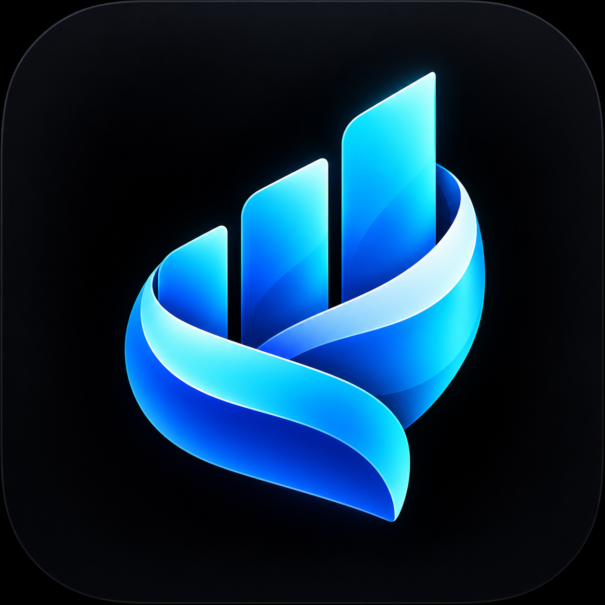
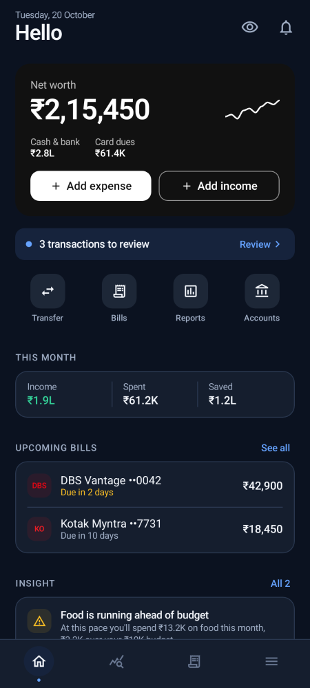
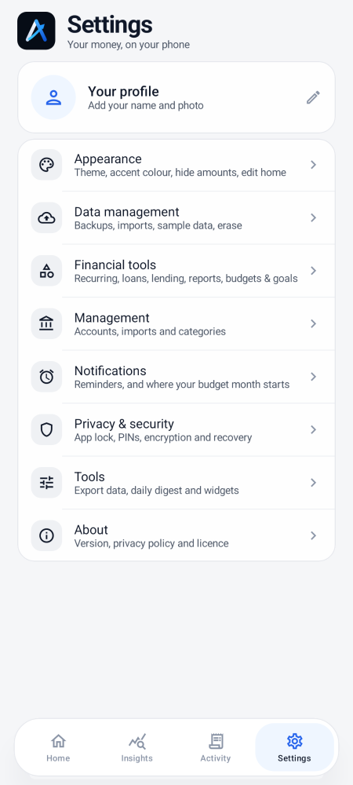
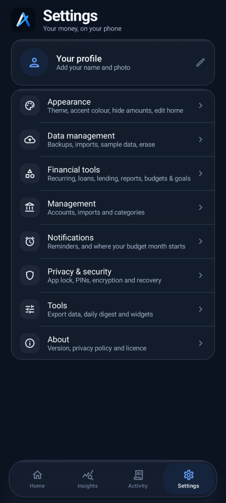
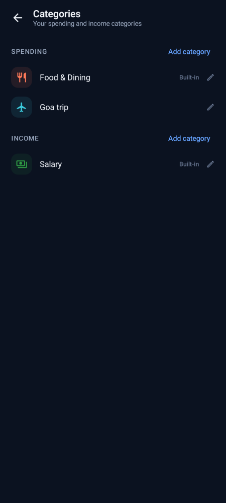
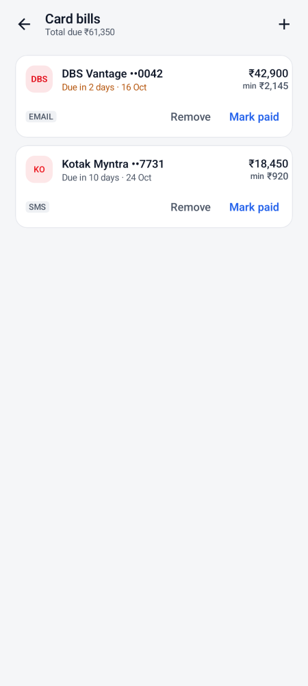

<h1 align="center">Sumvalo</h1>

<p align="center">
  
</p>

<p align="center">
  Offline-first personal finance for Android.<br/>
  Local-only, encrypted, no network permission — your money data never leaves the phone.
</p>

---

## About

Sumvalo is a personal-finance app built for privacy and offline use. Track income, expenses, credit cards, bills, budgets, and goals entirely on your device. Add transactions by hand, import bank-statement CSVs, or share bank SMS messages — every insight is computed locally, never uploaded.

Designed to be minimal, tactile, and glanceable: bold typography, clean hierarchy, restrained colors, and components sized for one-handed use.

---

## Features

- **Home dashboard** — net worth card, this-month income/spent/saved, upcoming bills, quick-add actions, and a “safe to spend” pill that respects your salary cycle
- **Accounts & cards** — balances that reconcile with your bank, card outstanding and utilization, mark-paid recording
- **Budgets & goals** — monthly budgets that follow your salary cycle with pace projection and rollover; savings goals with progress rings
- **Transactions** — add by hand or import bank-statement CSV (HDFC, ICICI, SBI, Axis, Kotak and others); tags, splits, IOUs, receipts (photo/PDF, encrypted)
- **Recurring & bills** — subscriptions, EMIs, UPI AutoPay / NACH mandates found in your spending; due-date reminders with price-change alerts
- **Reports & insights** — monthly & yearly PDF reports, Beancount & Ledger export, year-in-review, daily spending calendar, spending spikes, savings rate
- **Everyday tools** — home-screen widgets (this month, savings goal, spending by category, quick add), a Quick Settings tile, haptic feedback (Light/Standard/Strong), and a default-landing-tab choice

---

## Screenshots

<p align="center">
  
  
  
  
</p>

<p align="center">
  
  
  
  
</p>

---

## Getting Started

**Two builds, same app:**

| Build | SMS permission | Best for |
|-------|---------------|----------|
| **Standard** | Not requested | Share or paste bank messages; sideloads cleanly, Play Protect friendly |
| **Full** | Requested (opt-in) | Automatic inbox scan and notification capture; may trigger Play Protect warnings on sideload |

Download the signed APKs from the [Releases page](https://github.com/itsmeayusharyan/sumvalo/releases). Both variants share identical code, features, and signing key — upgrades install cleanly over previous versions.

Sumvalo targets Android 8.0+ (minSdk 26, targetSdk 35). The app requests no network permission — nothing can leave your phone.

---

## Development

**Prerequisites** — JDK 17+ (JDK 21 tested), Android SDK with `platforms;android-35` and `build-tools;35.0.0`, Gradle wrapper (8.9):

```bash
echo "sdk.dir=/opt/android-sdk" > local.properties   # or export ANDROID_HOME=/opt/android-sdk
./gradlew :app:assembleDebug
```

**Release build** — signing reads `keystore/sumvalo-release.jks` and two Gradle properties (`SUMVALO_STORE_PASSWORD`, `SUMVALO_KEY_PASSWORD`) from `~/.gradle/gradle.properties` — never in the repository:

```bash
./gradlew :app:assembleRelease
```

**Release checklist** (run against the signed artifact):

1. No INTERNET / network permission — `aapt2 dump permissions` is clean
2. Not debuggable, `allowBackup=false`, no unexpected exported components
3. Signature verifies against the Sumvalo release certificate — `apksigner verify`
4. No HTTP client classes or hardcoded URLs in the DEX
5. No analytics, ads, or tracking SDKs
6. SHA-256 hash recorded alongside release notes

Full details: [BUILDING.md](docs/BUILDING.md)

---

## Privacy

Sumvalo holds **no permission to access the network**. It cannot upload, sync, or share your data — not with us, not with any server, not with any third party. Everything stays on your device, in an encrypted database.

- **Encrypted at rest** — SQLCipher database (AES-256), key held in the Android Keystore
- **Backups** — AES-256-GCM with PBKDF2 (600k iterations), password only you know; Android cloud backup disabled
- **SMS is opt-in** — standard build never reads your inbox; full build reads bank SMS only after explicit consent, message bodies parsed in memory and never stored
- **App lock** — biometric or PIN, with decoy-PIN mode; privacy mode masks amounts everywhere
- **Local-only** — database, preferences, and datastore excluded from cloud backup and device transfer

Full policy: [PRIVACY.md](docs/PRIVACY.md)

---

## License

Sumvalo is free software under the [GNU General Public License v3.0 or later](LICENSE). It derives from the upstream **Kosh** project; each file keeps its original copyright notice.

Built with Kotlin + Jetpack Compose · SQLCipher · Material 3 · Offline first.
